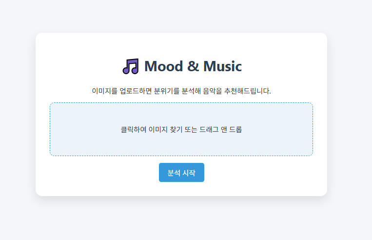
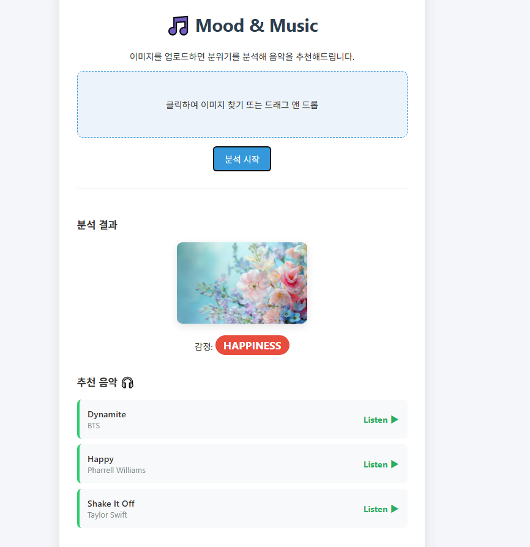

# Mood Music Recommender

Upload a photo, and the app infers its mood and recommends songs that match it.

The pipeline has two stages. An image is first turned into text with an image-captioning model. A text-emotion classifier then reads the caption, and songs are drawn from a library labeled by an audio-feature classifier.

| Main screen | Result |
| :---: | :---: |
|  |  |

## Pipeline

```
image ──► CLIP Interrogator (ViT-L/14) ──► caption ──► DistilBERT emotion classifier ──► emotion
                                                                                        │
song library (342 tracks, Spotify audio features) ──► MLP audio-emotion classifier ──► songs per emotion ──► 5 random picks
```

| Stage | Model | Data |
| --- | --- | --- |
| Image → caption | CLIP Interrogator, `ViT-L-14/openai` | — |
| Caption → emotion | `distilbert-base-uncased`, fine-tuned for 3 classes (sadness, anger, happiness) | Class-balanced text-emotion corpus (`image_classification/balanced_emotion_dataset.csv`) |
| Song → emotion | 2-layer MLP (hidden 64) on 7 scaled audio features, 7 emotion classes | 342 tracks (`music_classification/audio_feature_scale.json`) |

## Results

**Text-emotion classifier** (held-out test set, 1,791 samples, 3 balanced classes)

| Metric | Value |
| --- | --- |
| Accuracy | **87.05%** |
| Macro F1 | 0.87 |
| Per-class F1 | 0.86 / 0.90 / 0.86 |

Hyperparameters were tuned over early-stopping patience and weight decay (`image_classification/tunning.ipynb`; the search space is in `하이퍼파라미터 튜닝.txt`). The tuning runs reached 86.0–86.4% test accuracy, and the final model reached 87.05%.

**Audio classifier.** The audio classifier was trained for 100 epochs, and its training loss ended near 1.28 with 7 classes. It was **not** evaluated on a held-out set, so this repo reports no accuracy for it.

**Limitations**
- The image model never sees the image's emotion directly; it sees a caption. Captions from CLIP Interrogator mix in style tokens ("pexels contest winner", artist names), and these can mislead the classifier.
- The text classifier predicts 3 emotions, while the song library uses 7. The mapping uses only the overlapping labels.
- Spotify restricted its Audio Features API for new apps in late 2024, so `audio_feature.ipynb` may not run with a newly registered app.

## Getting started

Requires Python 3.8+. A CUDA GPU is recommended for Real Mode.

```bash
git clone https://github.com/Seungyeopkang/Music-recommendations-from-images.git
cd Music-recommendations-from-images
pip install -r requirements.txt
python app.py              # http://localhost:5000
```

**Real Mode vs. Demo Mode.** Trained weights are not included in this repo (`*.pth` is git-ignored).
- **Real Mode** needs both weight files. Train them with the scripts in `training/`, then place them at:
  - `image_classification/model.pth`
  - `music_classification/audio_emotion_classifier_scale.pth`
- **Demo Mode** runs if either file is missing. The app falls back automatically to a mock analyzer and a mock song list.

**Credentials.** Notebooks that call Hugging Face or Spotify use the placeholders `YOUR_HF_TOKEN`, `YOUR_SPOTIFY_CLIENT_ID`, and `YOUR_SPOTIFY_CLIENT_SECRET`. `image_classification/image_to_text.py` reads `HF_TOKEN` from the environment.

## Repository layout

```
app.py                      Flask app (upload → analyze → recommend)
modules/
  mood_analyzer.py          caption + emotion inference (with mock fallback)
  music_recommender.py      builds the per-emotion song DB from the audio model
templates/index.html        web UI
training/
  train_image_model.py      fine-tunes DistilBERT on the text-emotion corpus
  train_audio_model.py      trains the audio-feature MLP
image_classification/       captioning, tuning notebooks, datasets, caption results
image_emotion_bert/         tokenizer/config for the fine-tuned DistilBERT
music_classification/       Spotify feature collection, labeling notebook, song features
excel_file/                 per-emotion song lists used for labeling
```
